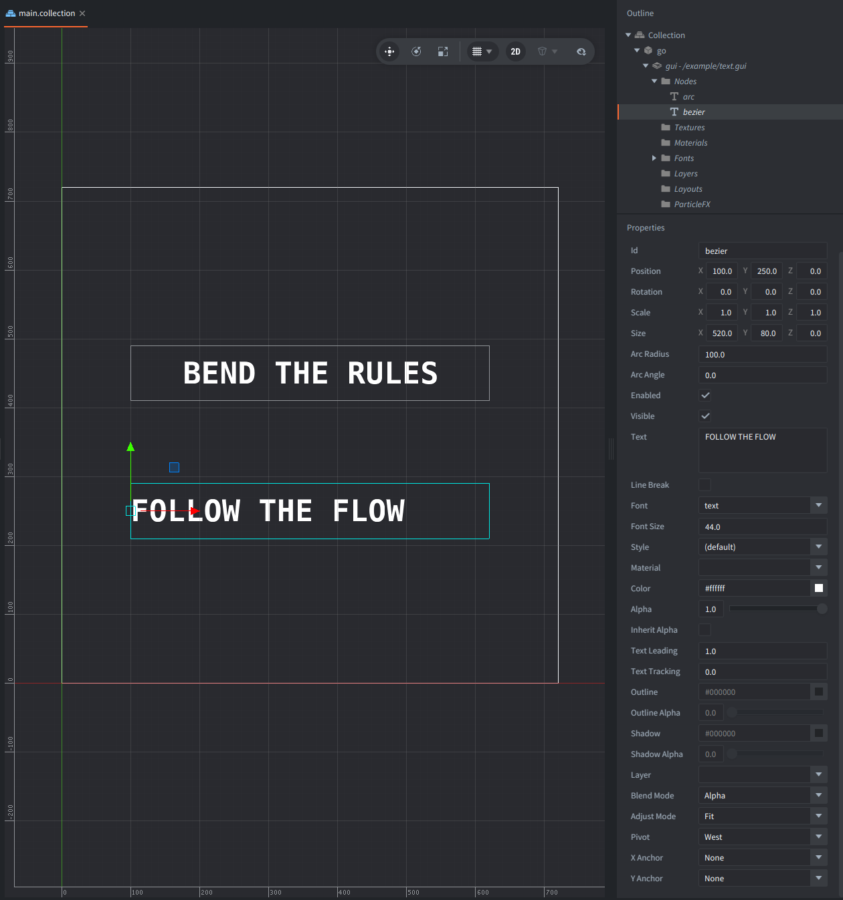

This example demonstrates how to render Rich Text along a circular arc and a cubic Bézier curve using vector fonts.
The arc radius and the Bézier handles are animated too.

Support for arc and curves for text was introduced in Defold 1.14.2.

## Setup

The collection contains one game object with a GUI component and two text nodes:
- `arc`
- `bezier`

Both use the same dynamic vector font and the accompanying GUI script listed below.

Enable **Use Rich Text** in the App Manifest for Rich text markup feature. We use `example.appmanifest` in the example.

The example uses the built-in Vera Mono Bold font, so no additional assets are needed.

## How It Works

In `init()`, the vector font glyphs are prewarmed with `font.prewarm_text()`. Once the font is ready, in the callback we set the Rich Text strings, including gradient, size and wave tags.

For the first node, using `gui.set()` we set the `arc_radius` and `arc_angle` properties. The node origin is the center of the circle. Using `gui.animate()` we can change the arc properties continuously.

For the second node, `gui.set_curve()` defines a cubic Bézier curve with two knots. Their positions are relative to the text node, and their handles are relative to each knot.
In `update()`, we are changing the handles and setting the curve again to animate the knots.

A custom curve takes precedence over the arc. Use `gui.set_curve(node, nil)` to remove it, or set `arc_angle` to zero to disable arc layout when no custom curve is active. Both layout types also work on Label components using `go.set()` and `label.set_curve()`.

See the [GUI API](https://defold.com/ref/beta/gui-lua/#gui.set_curve:node-knots-options) and [Rich Text manual](https://defold.com/manuals/font-richtext/).
