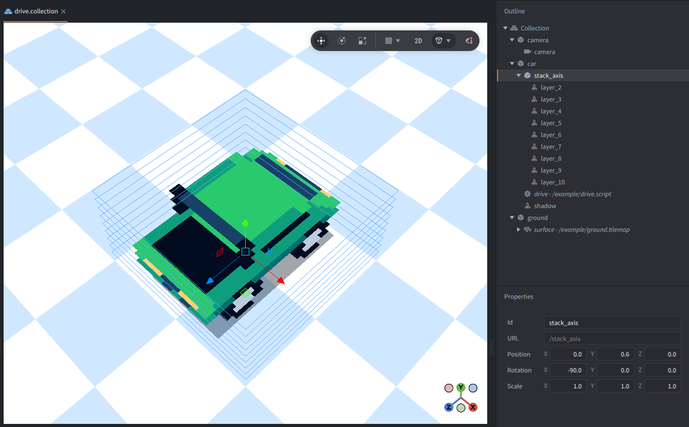
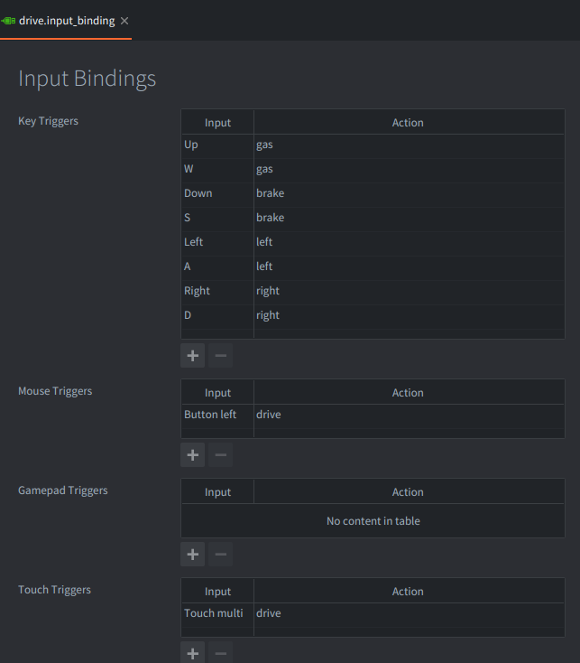
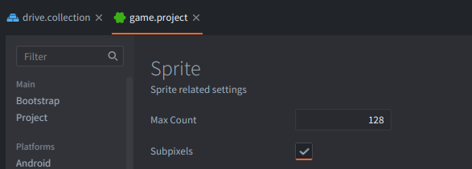

The examples shows a simple car controller with smooth camera following it and the car is made out of layers or sprites stacked on top of each other.

Drive around with key, mouse or touch controls:

| Action | Keyboard | Mouse or touch |
| --- | --- | --- |
| Accelerate | <kbd>↑</kbd> or <kbd>Up</kbd> | Press/touch and hold |
| Left | <kbd>A</kbd> or <kbd>←</kbd> | Drag left from the press point |
| Right | <kbd>D</kbd> or <kbd>→</kbd> | Drag right from the press point |
| Brake/Reverse | <kbd>S</kbd> or <kbd>↓</kbd> | Drag down from the press point |

The camera will follow it moving or orbit around the stopped car.

## Setup

The collection includes 3 game objects:
- `camera` with `camera` component - that will be following the car
- `car` with `drive.script` and a single `shadow` sprite at the bottom, plus a child game object:
    - `stack_axis` which contains 9 `sprite` components - being layers of the car's stack
- `ground` with `tilemap` component for the ground representation.

The green car sheet contains 10 tiles of size 16×16.

The shadow sprite in `car` uses `layer_1`. The sprites on `stack_axis` use the remaining layers in sheet order, spaced 1 units apart along the stack’s local Z axis, which points up along world Y. Both texture filters use nearest sampling.

With this setup car can have nice tilt effect when rotating the `stack_axis`, but shadow can stay on the ground.

The `ground` object holds a fixed 20×20 tilemap on the XZ plane. The ground material uses Defold's tilemap shaders with the `model` tag so the default renderer draws the opaque ground before the transparent car slices.

A separate `camera` object has the perspective camera component.

We also use the following input bindings:

Keep Sprite → Subpixels enabled to prevent the stack from jumping during movement.

## How It Works

Sprite stacking is a method to create 3D-like visuals using only a stack of 2D sprites. By adding an offset between them and using proper camera angle (or using parallax effect), we could make the stack look like 3D. The amount of layers should be roughly of the same size as pixels, so it works well with pixel art, but can be used with other styles as well.

The `drive.script` is designed to control a car with a signed speed toward a target each frame. Accelerating, braking or steering as a response to key, mouse or touch input allows to change the current direction. Steering rotates the car around Y, with the turn direction reversed when driving backward. The script rotates the forward vector by that heading and uses it to advance the car.

The car root turns with the steering vector, but its child `stack_axis` pitches and rolls to response visually to the movement. A change in speed raises or lowers the nose. Steering left/right banks the body outward, with more lean at higher speed. We use `vmath.slerp()` to ease the stack movement.

The script gets the bounds of the tilemap with `tilemap.get_bounds()` and the position is clamped inside a rectangle defined by these bound, minus a small margin for the car's corners. Reaching a limit makes the car stop.

When car is not moving, the camera orbits around its target, and when we move the car, it follows. Blending by speed allows us to settle the camera behind the car after after it was stopped and camera was revolving around it.

## Credits

Car sprites - one of the sprite sheets from *Sprite Stack Cars* by *edu*. The creator permits use “in any project.” [Creator's terms and original pack](https://edusilvart.itch.io/sprite-stack-cars).

The tilemap uses a basic color map from *Prototype Kit* by *Kenney*, distributed under CC0 1.0. [Asset source and license](https://kenney.nl/assets/prototype-kit).
