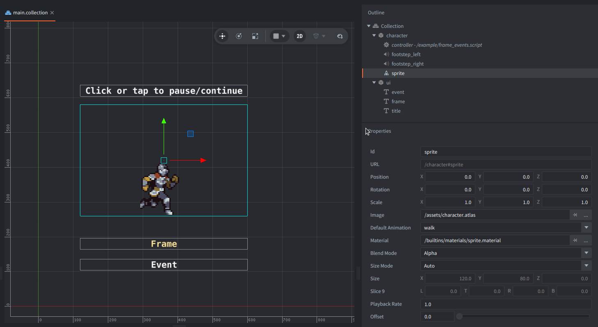

This example triggers events (label information and footstep sound) on given frames of a looping Sprite animation.
Click or tap to pause and then again to resume the flipbook.

## Setup

The main collection contains a character game object with:
- a sprite component that plays `walk` from `character.atlas` by default,
- a script component `frame_events.script`,
- 2 sound components with footstep audio

Additionally there is a game object with labels for UI information.

## How It Works

`FRAME_EVENTS` and `FRAME_EVENTS_FOOTSTEPS` contains a map of selected frame numbers with assigned actions (label text and sound component URL to play).

In `update()`, the script converts the normalized sprite `cursor` and `frame_count` into a 1-based current frame number.

When the frame changes, the script checks the frames crossed in between, including wraparound from the last to the first frame.

If a frame has an event, a label briefly flashes to indicate the event occured and sound of a footstep is played.

The normal flipbook completion callback doesn't fire during continuous looping.

This detects frame changes once per update.

## Credits

Free Fantasy Knight by Nauris Amatnieks, License: https://aamatniekss.itch.io/fantasy-knight-free-pixelart-animated-character

Footsteps sounds (cropped) by Fission9, CC0: https://freesound.org/people/Fission9/sounds/521589/